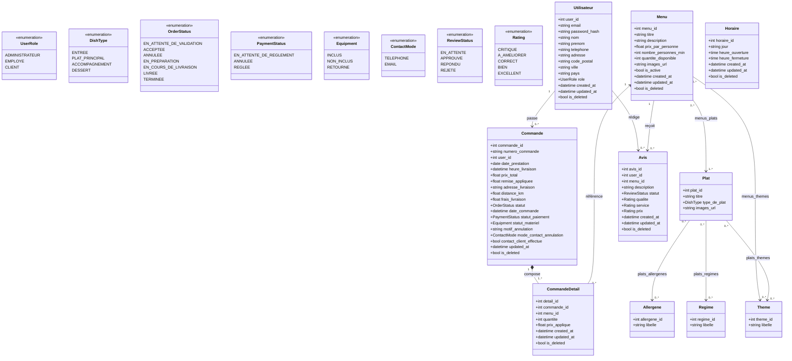

# Diagramme de Classes — Vite & Gourmand (UML)

Ce diagramme modélise l'architecture complète des entités relationnelles, leurs énumérations métier associées, ainsi que leurs relations et cardinalités. Il est en stricte conformité avec le schéma PostgreSQL (`create_db.sql`) et les modèles SQLAlchemy du backend (`models.py`).

---

## 1. Diagramme Mermaid

---

## 2. Visuels Exportés
* Format SVG : `docs/diagrammes/Diagramme-de-classes.svg`
* Format PNG : `docs/diagrammes/Diagramme-de-classes.png`