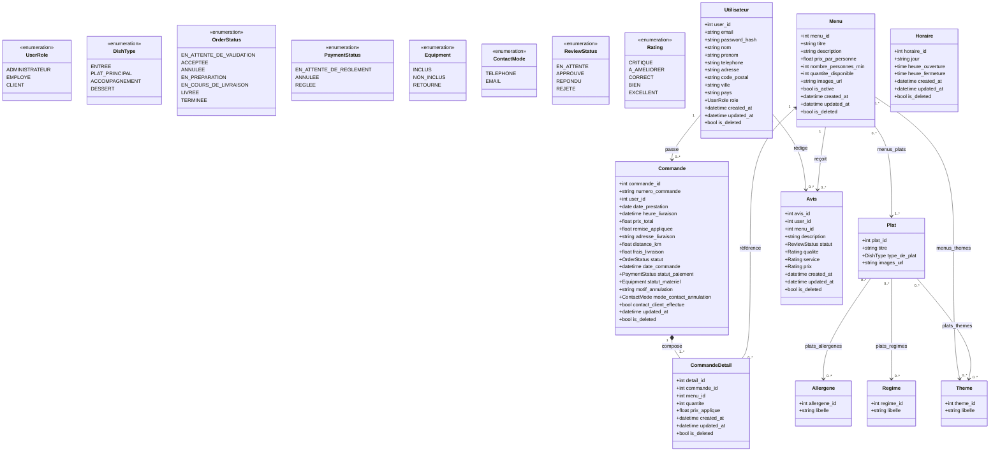

# Modélisation & Cartographie des Données — Vite & Gourmand

> Référentiel technique de conception de la persistance des données pour l'application **Vite & Gourmand** (Titre professionnel Développeur Web et Web Mobile - RNCP 37674).  
> Ce document formalise le schéma relationnel, les énumérations métier, la cartographie logicielle multicouche et la justification de la persistance polyglotte (PostgreSQL + MongoDB).

---

## 1. Diagramme de Classes & Modèle Relationnel (UML / Mermaid)

Ce schéma modélise les entités du domaine, leurs attributs, leurs types énumérés et leurs cardinalités, en conformité avec le script d'initialisation `backend/sql/create_db.sql` et les modèles SQLAlchemy de l'API.



---

## 2. Cartographie Multicouche des Données (Mapping)

Cette matrice assure la cohérence des entités à travers les 4 couches de l'application :

1. **Base relationnelle (PostgreSQL)** : Schéma DDL, contraintes d'intégrité et clés étrangères.
2. **Couche ORM (SQLAlchemy)** : Modèles Python objet-relationnel.
3. **Contrats d'API (Pydantic DTO)** : Validation stricte des entrées et sérialisation des sorties JSON.
4. **Base orientée document (MongoDB)** : Stockage dénormalisé, analytique ou modération directe.

| Entité | Rôle Métier | Table PostgreSQL | Modèle ORM (SQLAlchemy) | Schémas DTO (Pydantic) | Persistance NoSQL (MongoDB) |
| --- | --- | --- | --- | --- | --- |
| **Utilisateur** | Gestion des comptes, authentification JWT et contrôle des accès selon les rôles. | `utilisateurs` | `models.Utilisateur` | `UserBase`, `UserCreate`, `UserRead` | — *(non concerné)* |
| **Menu** | Produit principal du catalogue commercial, gestion des portions et décrémentation des stocks. | `menus` | `models.Menu` | `MenuBase`, `MenuRead` | Référencé sous forme dénormalisée dans `commandes_stats` |
| **Plat** | Composant culinaire élémentaire assemblé dans les menus ; support des régimes et allergènes. | `plats` | `models.Plat` | `PlatBase`, `PlatRead` | — *(non concerné)* |
| **Commande** | Suivi transactionnel, logistique de livraison, caution matériel et audit d'annulation. | `commandes` | `models.Commande` | `CommandeBase`, `CommandeRead` | Projetée au statut `Terminée` dans `commandes_stats` |
| **Détail Commande** *(Ligne Panier)* | Association entre une commande et les menus choisis, avec figeage du prix unitaire facturé. | `commande_details` | `models.CommandeDetail` | `CommandeDetailBase` | Intégré comme tableau imbriqué (`menus: [...]`) dans `commandes_stats` |
| **Avis Client** | Notation multicritère (qualité, service, prix), retour d'expérience et workflow de modération. | `avis` *(miroir / intégrité)* | `models.Avis` | `AvisBase`, `AvisRead` | Collection `avis` *(source de données active et modération en direct)* |
| **Horaire** | Plages horaires d'ouverture et de commande du restaurant traiteur. | `horaires` | `models.Horaire` | `HoraireBase`, `HoraireRead` | — *(non concerné)* |
| **Référentiels** *(Thèmes, Régimes, Allergènes)* | Taxonomie pour la recherche multicritère et la sécurité alimentaire des clients. | `themes`, `regimes`, `allergenes` | `models.Theme`, `models.Regime`, `models.Allergene` | `ThemeBase`, `RegimeBase`, `AllergeneBase` | — *(non concerné)* |
| **Statistiques Décisionnelles** *(Reporting Admin)* | Agrégation des volumes de vente et calculs de CA pour les graphiques administrateur. | — *(aucune requête analytique lourde sur l'OLTP)* | — | `StatsResponse`, `DatasetGraphique` | Collection `commandes_stats` *(pipeline d'agrégation `$match`, `$group`)* |

---

## 3. Référentiel des Types Énumérés (PostgreSQL & Python)

Les types énumérés fixent les machines d'états et garantissent l'intégrité des transitions métier au niveau de la base de données (`CREATE TYPE`) et dans le code Python (`Enum`).

### 3.1 Statuts de Commande (`order_status`)

Gère le cycle de vie séquentiel et logistique de la commande :

* `En attente de validation` : Commande créée par le client, en attente de vérification par l'équipe.
* `Acceptée` : Commande confirmée, lien de paiement émis.
* `Annulée` : Commande annulée (par le client avant validation, ou par le restaurant avec contact obligatoire).
* `En préparation` : Menus en cours de fabrication en cuisine.
* `En cours de livraison` : Prise en charge par le livreur en direction du lieu de prestation.
* `Livrée` : Commande et matériel remis au client.
* `Terminée` : Clôture administrative (livrée, soldée financièrement et matériel restitué).

### 3.2 Statuts de Règlement (`payment_status`)

Découplé du statut logistique pour autoriser le paiement en ligne ou à réception :

* `En attente de règlement` : Paiement non encore encaissé.
* `Réglée` : Règlement validé par carte bancaire (webhook) ou encaissement direct (TPE / espèces).
* `Annulée` : Transaction financière clôturée suite à refus de commande.

### 3.3 Statuts du Matériel Prêté (`equipment`)

Encadre la mise à disposition des équipements de service (chafing dishes, vaisselle) et les clauses CGV :

* `Inclus` : Matériel prêté en attente de restitution (délai légal de 10 jours ouvrés).
* `Non inclus` : Aucun matériel consigné, ou dossier basculé en litige (pénalité forfaitaire de 600 €).
* `Retourné` : Matériel restitué complet et déclaré conforme par l'employé.

### 3.4 Rôles Utilisateurs (`user_role`)

Contrôle d'accès basé sur les rôles (RBAC) :

* `Visiteur` : Rôle implicite non authentifié (consultation catalogue).
* `Client` : Utilisateur standard authentifié (passation de commande, suivi, factures).
* `Employé` : Personnel de service (gestion du catalogue, mise à jour des commandes, modération avis).
* `Administrateur` : Gérant du restaurant (gestion RH des employés, tableaux de bord financiers).

### 3.5 Modération & Avis (`review_status` & `notes`)

* **Statuts d'Avis (`review_status`)** : `En attente`, `Approuvé`, `Répondu`, `Rejeté`.
* **Échelle d'évaluation (`notes`)** : `Critique` (1), `À améliorer` (2), `Correct` (3), `Bien` (4), `Excellent` (5).

---

## 4. Justification de la Persistance Polyglotte (PostgreSQL vs MongoDB)

| Critère de Conception | Base Relationnelle (PostgreSQL) | Base Orientée Document (MongoDB) |
| --- | --- | --- |
| **Rôle applicatif principal** | Transactionnel pur (OLTP) | Analytique & Flexibilité (OLAP / Messages) |
| **Garanties** | Respect strict des propriétés ACID (Atomicité, Cohérence, Isolation, Durabilité). | Modèle de données flexible sans schéma rigide (*schema-less*), requêtes d'agrégation rapides. |
| **Périmètre des données** | Utilisateurs, catalogue commercial, commandes, lignes de facturation, horaires. | Messages de contact, avis clients, documents dénormalisés `commandes_stats`. |
| **Objectif de performance** | Empêcher les réservations incohérentes et garantir la validité des règlements financiers. | Isoler les calculs statistiques lourds (CA par période, popularité) pour ne jamais ralentir les commandes en direct. |

```