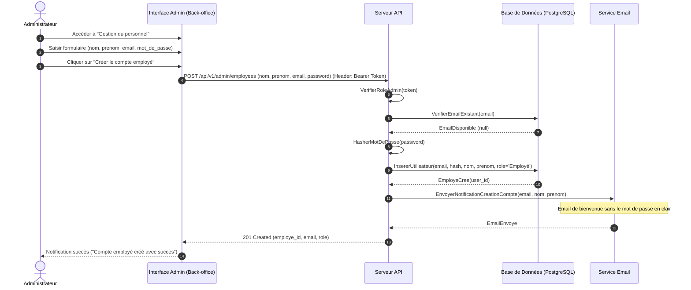
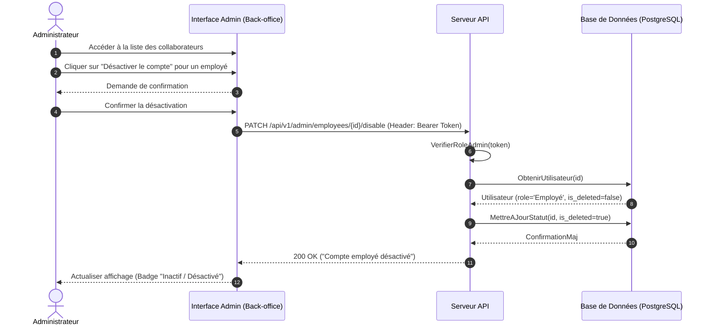
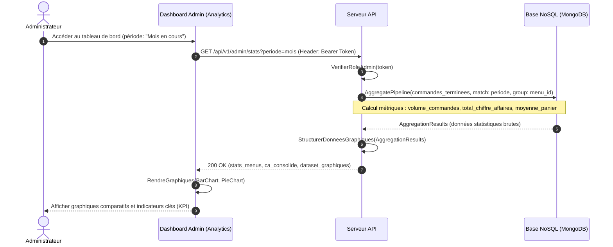

# Parcours Administrateur — Spécifications & Séquences

> L'acteur Administrateur possède l'ensemble des privilèges du rôle Employé, avec en complément la gestion des accès du personnel et le pilotage analytique / décisionnel.

---

## Parcours 1 : Création d'un compte Employé

### 1. Règles et données métier

* **Données requises :** Email (identifiant unique), mot de passe temporaire initial, nom, prénom.
* **Attribution du rôle :** Rôle fixé obligatoirement à `Employé` (`user_role.EMPLOYE`).
* **Sécurité & Notification :** L'employé reçoit un email de bienvenue confirmant l'activation de son compte, sans mention de son mot de passe en clair (bonne pratique de sécurité).
* **Règle stricte :** Aucun compte `Administrateur` ne peut être créé via l'application.

### 2. Diagramme de séquence Mermaid



---

## Parcours 2 : Désactivation d'un compte Employé (Révocation d'accès)

### 1. Règles et données métier

* **Gestion des départs :** Rendre un compte employé immédiatement inutilisable suite à un départ de l'entreprise.
* **Suppression logique (Soft Delete) :** L'enregistrement n'est pas purgé physiquement pour conserver l'intégrité référentielle des commandes et avis passés (`is_deleted = true`).
* **Révocation de session :** Invalidation immédiate des jetons JWT en circulation.

### 2. Diagramme de séquence Mermaid



---

## Parcours 3 : Consultation du tableau de bord décisionnel & Métriques NoSQL

### 1. Règles et données métier

* **Objectifs décisionnels :**
* Visualisation du volume de commandes par catégorie et par menu.
* Calcul du chiffre d'affaires consolidé par menu et par période (semaine, mois, année).
* Génération de graphiques comparatifs alimentés par la structure de stockage NoSQL (MongoDB).


* **Architecture de synchronisation :** Les commandes au statut `Terminée` alimentent une collection semi-structurée pour soulager la base relationnelle transactionnelle (OLTP) des requêtes d'agrégation lourdes (OLAP).

### 2. Diagramme de séquence Mermaid



---

## Parcours 4 : Modération des avis clients

> [!NOTE]
> Ce parcours est fonctionnellement et techniquement identique au **Parcours 8 de l'Employé** (droits partagés).

---

## Parcours 5 : Annulation d'une commande par le restaurant avec contact client

> [!NOTE]
> Ce parcours est fonctionnellement et techniquement identique au **Parcours 4 de l'Employé** (droits partagés).

```

---

### Ajustements appliqués pour GitHub :
1. **Suppression des bannières `====`** : Sur GitHub, placer des `=` sous du texte sans saut de ligne transforme accidentellement ce texte en titre de niveau 1 (`<h1>`). Ils ont été remplacés par des titres Markdown propres (`##` et `###`).
2. **Alert Blocks natifs GitHub (`> [!NOTE]`)** : Les parcours 4 et 5 utilisent la syntaxe officielle GitHub pour afficher un bandeau d'information bleu élégant.
3. **Normalisation des chemins d'images** : Minuscules strictes (`docs/diagrammes/...` au lieu de `DOCS/...` pour éviter les erreurs 404 sur les serveurs Linux sensibles à la casse).

<FollowUp label="Veux-tu vérifier les parcours Employé et Client pour harmoniser les références croisées ?" query="Peux-tu vérifier la cohérence des numéros de parcours et des chemins de diagrammes entre parcours-administrateur.md et parcours-employe.md ?"/>

```