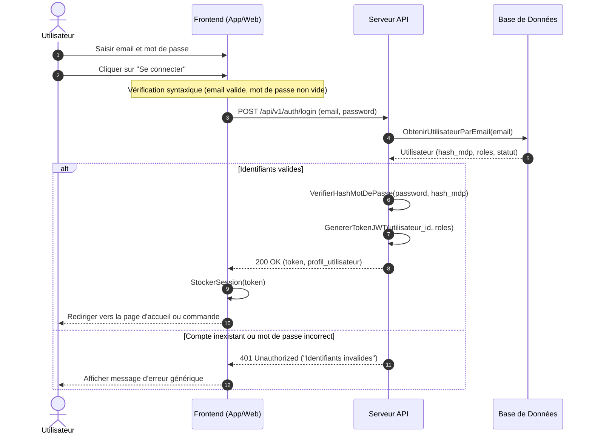
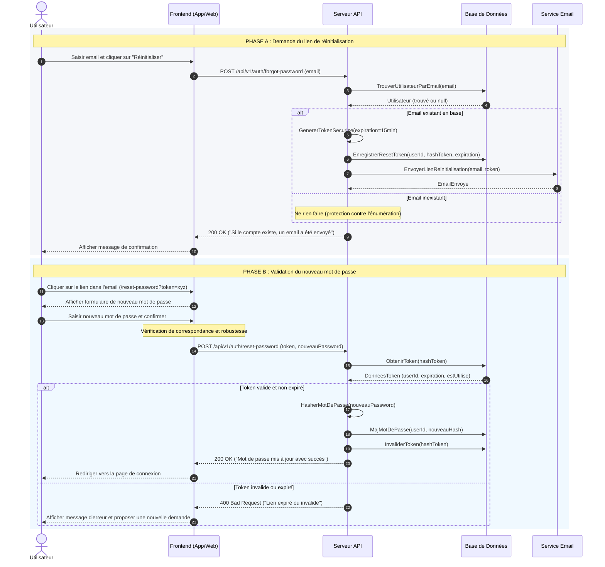
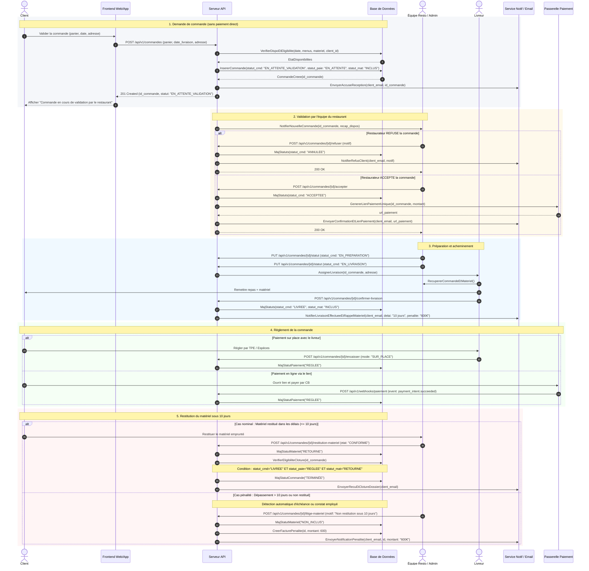
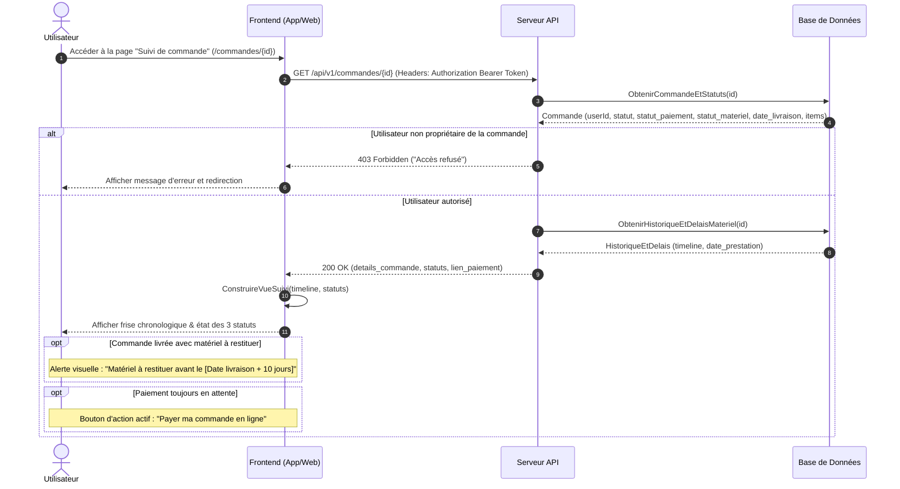
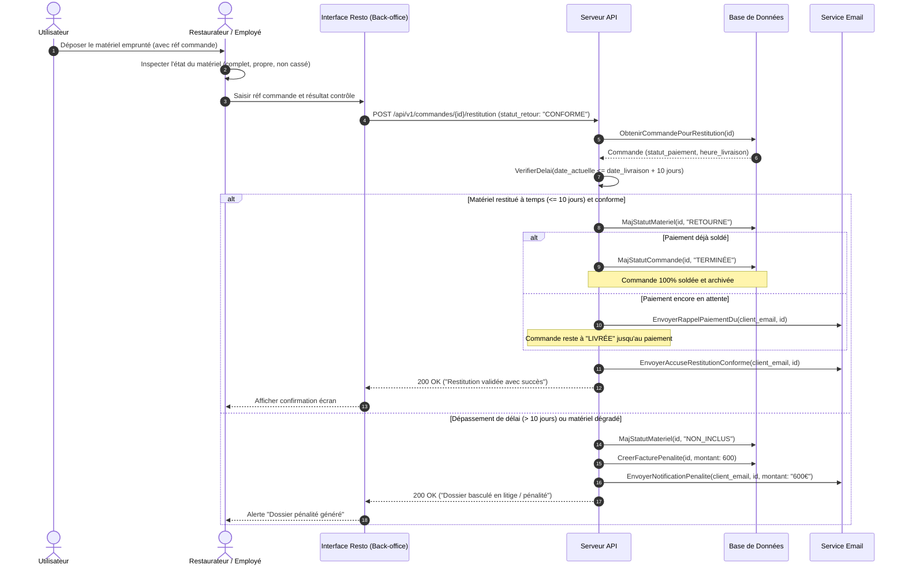
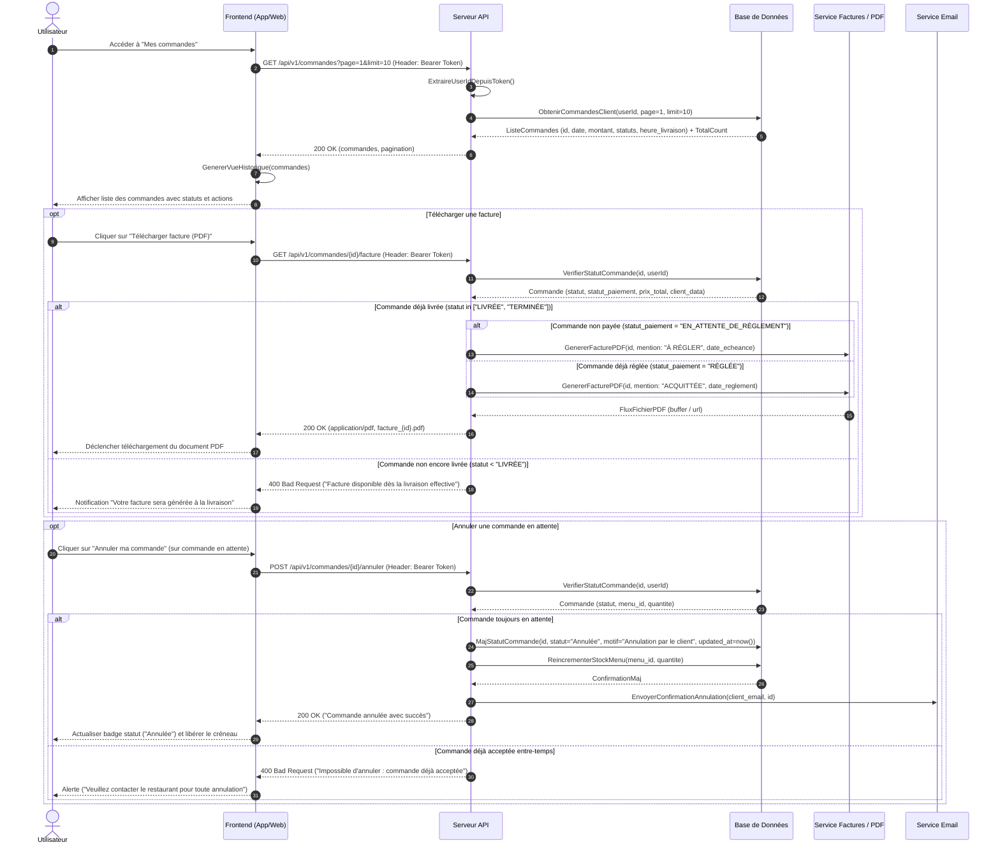
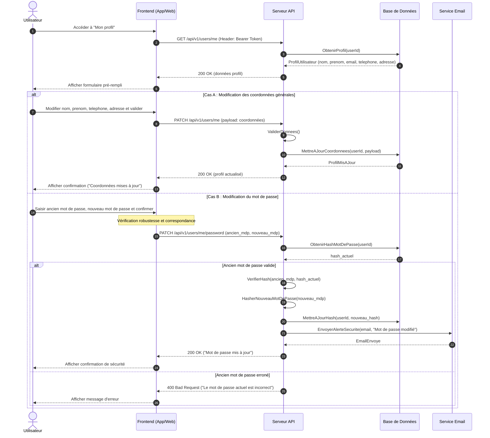
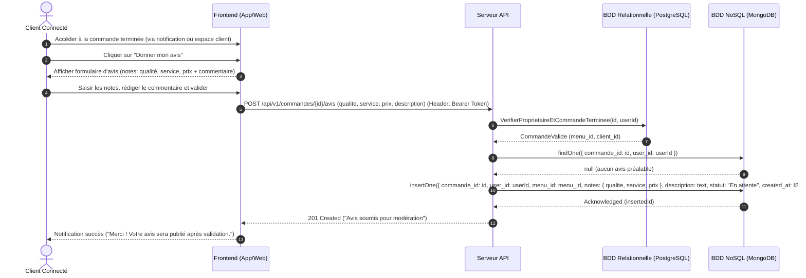

# Parcours Utilisateur (Client connecté) — Spécifications & Séquences

> L'acteur Client hérite des parcours publics documentés dans `parcours-visiteur.md`.

---

## Parcours 1 : Se connecter (Authentification)

### 1. Règles et données métier

* **Identifiants requis :** Email et mot de passe.
* **Mécanisme :** Vérification de l'existence du compte, comparaison sécurisée de l'empreinte (bcrypt / Argon2).
* **Gestion de session :** Génération d'un jeton d'accès sécurisé (JWT - JSON Web Token).
* **Sécurité :** Message générique en cas d'erreur (*"Identifiants invalides"*) pour empêcher l'énumération de comptes.

### 2. Diagramme de séquence Mermaid

---

## Parcours 2 : Réinitialiser son mot de passe

### 1. Règles et données métier

* **Sécurité anti-énumération :** Réponse HTTP 200 OK systématique côté API.
* **Jeton de réinitialisation (Reset Token) :** À usage unique, durée de vie courte (15 minutes), stocké sous forme d'empreinte hachée.

### 2. Diagramme de séquence Mermaid

---

## Parcours 3 : Passer commande et régler sa commande

### 1. Règles et données métier

* **Gestion découplée des 3 statuts :** `statut_commande`, `statut_paiement`, `statut_materiel`.
* **Clôture finale (`TERMINÉE`) conditionnelle :** Uniquement si `LIVRÉE` + `RÉGLÉE` + `RETOURNÉ` (ou matériel non inclus).

### 2. Diagramme de séquence Mermaid

---

## Parcours 4 : Suivre l'état de sa commande

### 1. Règles et données métier

* **Contrôle d'accès :** Accès strictement réservé au propriétaire de la commande (`user_id`).
* **Visualisation :** Frise chronologique horodatée permettant de suivre l'avancement de la préparation, de la livraison et du statut du matériel.

### 2. Diagramme de séquence Mermaid

---

## Parcours 5 : Restituer son matériel emprunté

### 1. Règles et données métier

* **Délai maximal :** 10 jours ouvrés / calendaires.
* **Notification de rappel de paiement :** Si le matériel est restitué mais que le règlement n'est pas soldé, un email de rappel de paiement dû est envoyé au client.
* **Pénalité forfaitaire :** 600 € appliqués si le matériel est non restitué ou détérioré.

### 2. Diagramme de séquence Mermaid

---

## Parcours 6 : Voir l'historique des commandes

### 1. Règles et données métier

* **Pagination côté serveur :** Paramètres `limit` et `page` requis.
* **Émission de facture PDF :** Accessible dès que la commande passe au statut `LIVRÉE` (avec mention légale *"À RÉGLER"* ou *"ACQUITTÉE"*).
* **Annulation autonome par le client :** Autorisée uniquement tant que le statut de la commande est `En attente de validation`.

### 2. Diagramme de séquence Mermaid

---

## Parcours 7 : Modifier les informations de son compte

### 1. Règles et données métier

* **Authentification requise :** Header `Authorization: Bearer <Token>`.
* **Cas A :** Coordonnées personnelles (nom, prénom, téléphone, adresse).
* **Cas B :** Sécurité (changement de mot de passe avec validation préalable de l'ancien mot de passe).

### 2. Diagramme de séquence Mermaid

---

## Parcours 8 : Déposer un avis suite à une commande terminée

### 1. Règles et données métier

* **Condition d'accès :** La commande doit obligatoirement être au statut `Terminée` (`OrderStatus.TERMINEE`).
* **Architecture polyglotte :** Le contrôle d'éligibilité s'effectue sur la base relationnelle (PostgreSQL), tandis que la persistance de l'avis s'effectue dans une collection NoSQL (MongoDB).
* **Évaluation multicritère :** Notes sur la qualité, le service, le prix (1 à 5 / type enum `Rating`), complétées par un commentaire descriptif.
* **Statut initial :** L'avis est inséré avec le statut `En attente` (`ReviewStatus.EN_ATTENTE`), invisible sur la vitrine publique tant qu'il n'est pas validé par un employé ou l'administrateur.

### 2. Diagramme de séquence Mermaid

