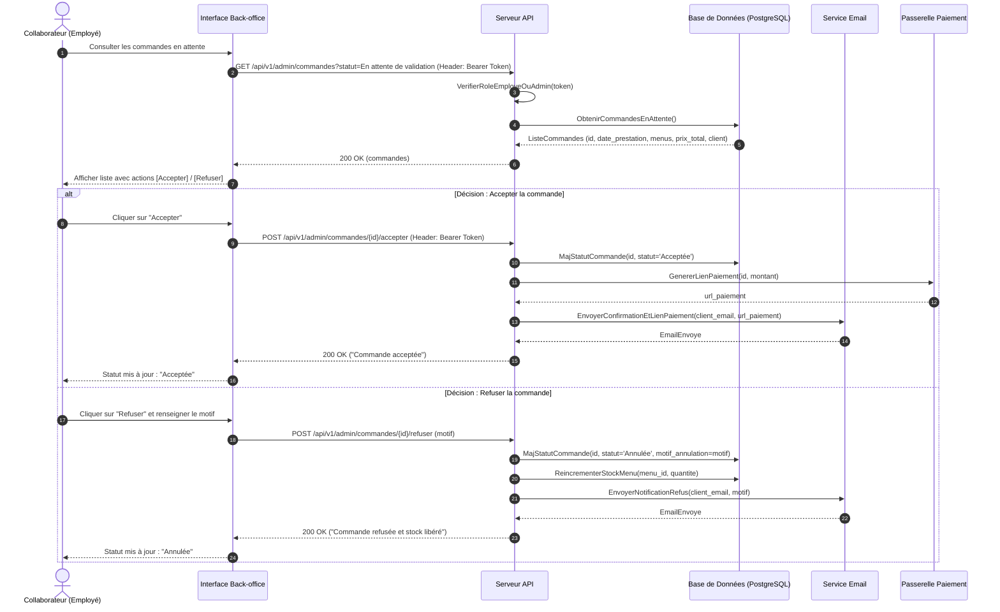
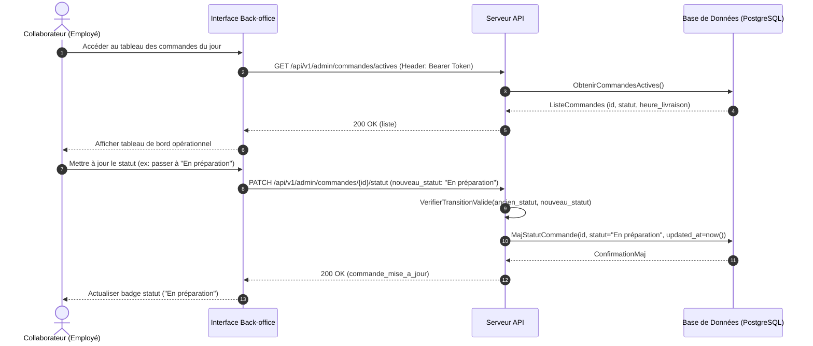
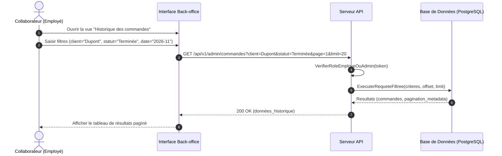
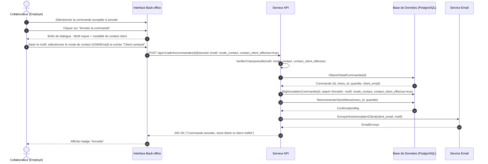
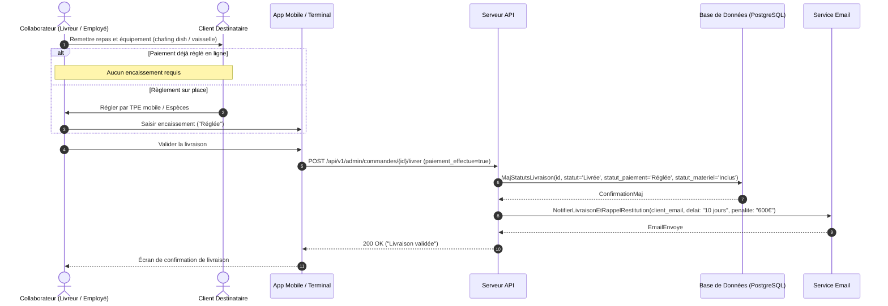
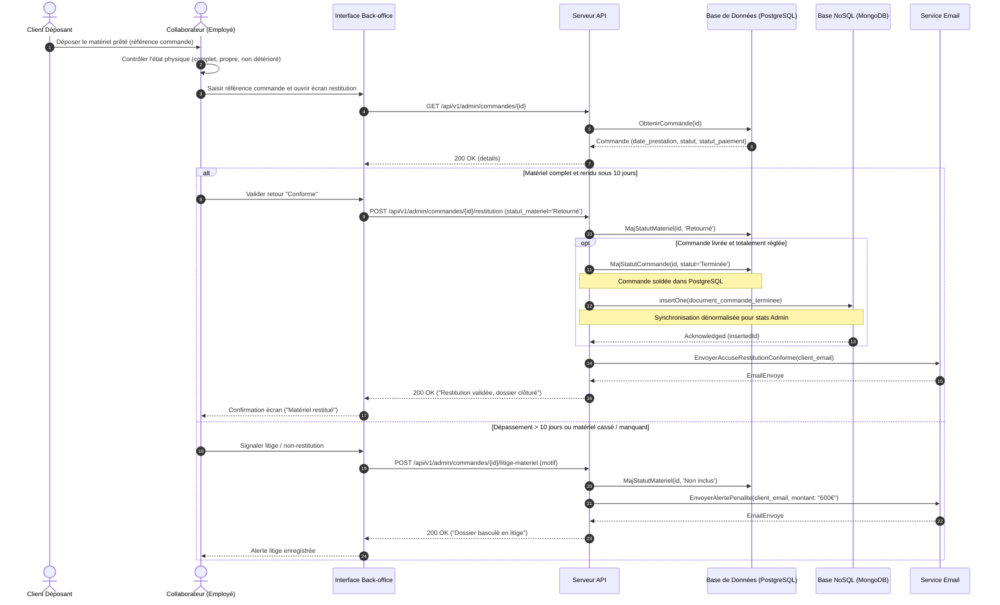
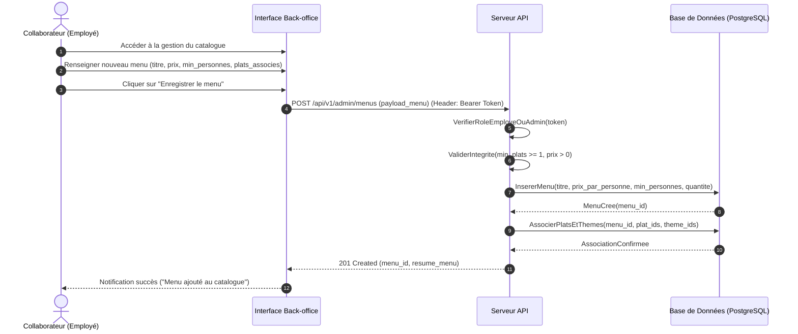
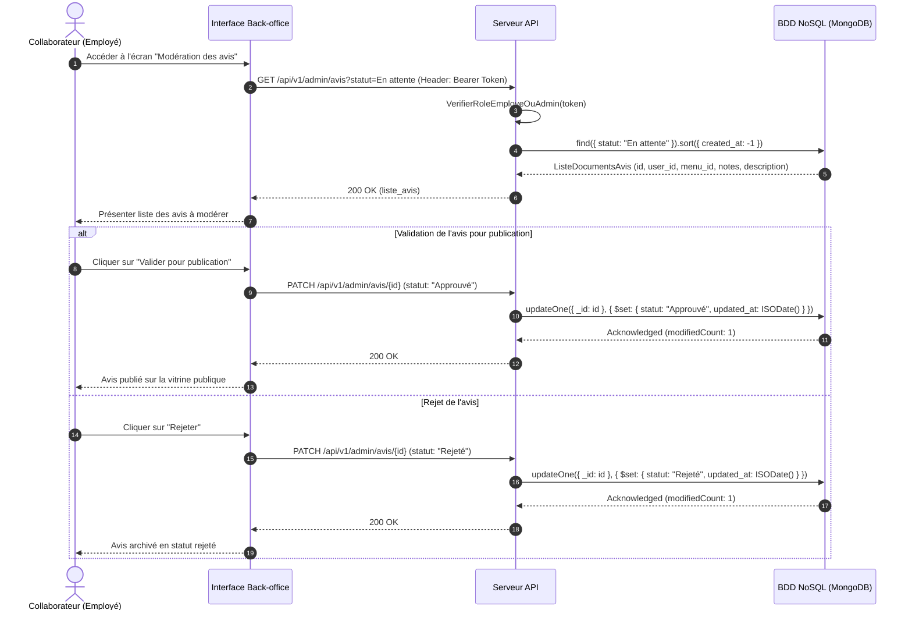

# Parcours Collaborateur (Employé) — Spécifications & Séquences

> Cet acteur hérite des parcours publics documentés dans `parcours-visiteur.md` et `parcours-client.md` :
> - Visiter la boutique, filtrer, consulter le détail
> - Se connecter (Authentification)
> - Réinitialiser son mot de passe
> - Prendre contact
> - Modifier les informations de son compte

---

## Parcours 1 : Validation d'une commande client (Acceptation / Refus)

### 1. Règles et données métier

* **Point d'entrée :** Commandes arrivant avec le statut `En attente de validation` (`OrderStatus.EN_ATTENTE_DE_VALIDATION`).
* **Contrôle préalable :** L'employé vérifie la faisabilité opérationnelle en cuisine et les stocks disponibles.
* **Décision :**
  * **Acceptée** (`OrderStatus.ACCEPTEE`) : Déclenche la génération du lien de paiement sécurisé et l'envoi d'un email de confirmation au client.
  * **Refusée / Annulée** (`OrderStatus.ANNULEE`) : Saisie obligatoire du motif de refus, notification email au client et réincrémentation des stocks (`quantite_disponible`).

### 2. Diagramme de séquence Mermaid

---

## Parcours 2 : Suivi et mise à jour des statuts de préparation et livraison

### 1. Règles et données métier

* **Transitions ordonnées :** `Acceptée` $\rightarrow$ `En préparation` $\rightarrow$ `En cours de livraison` $\rightarrow$ `Livrée`.
* **Historisation :** Mise à jour automatique de la colonne technique d'audit `updated_at`.
* **Règles d'accès :** Réservé aux utilisateurs disposant du rôle `Employé` ou `Administrateur`.

### 2. Diagramme de séquence Mermaid

---

## Parcours 3 : Consultation de l'historique et recherche multicritère

### 1. Règles et données métier

* **Filtres multicritères :** Recherche par identifiant/nom de client, statut de commande, statut de paiement, ou plage de dates de prestation.
* **Pagination :** Implémentation de la pagination serveur (`page`, `limit`) pour préserver les performances de la base de données.

### 2. Diagramme de séquence Mermaid

---

## Parcours 4 : Annulation d'une commande acceptée avec contact client obligatoire

### 1. Règles et données métier

* **Règle métier stricte (Cahier des charges) :** Interdiction d'annuler une commande acceptée sans avoir préalablement contacté le client (par téléphone ou email).
* **Traçabilité requise :** Saisie obligatoire de `motif_annulation` (texte), sélection de `mode_contact_annulation` (`Téléphone` ou `Email`), et attestation `contact_client_effectue = true`.
* **Rétablissement des stocks :** Restitution automatique des quantités réservées dans la table `menus`.

### 2. Diagramme de séquence Mermaid

---

## Parcours 5 : Livraison de la commande et encaissement sur place

### 1. Règles et données métier

* **Double action :** Remise de la marchandise et du matériel consigné, puis régularisation du règlement si non payé en ligne.
* **Mise à jour des statuts :**
* `statut` passe à `'Livrée'` (`OrderStatus.LIVREE`).
* `statut_paiement` passe à `'Réglée'` (`PaymentStatus.REGLEE`).
* `statut_materiel` passe à `'Inclus'` (`Equipment.INCLUS`).

* **Activation du délai de restitution :** Déclenchement du délai de 10 jours ouvrés pour la restitution du matériel, sous peine de 600 € d'indemnité forfaitaire mentionnée aux CGV.

### 2. Diagramme de séquence Mermaid

---

## Parcours 6 : Réception et contrôle de conformité du matériel retourné

### 1. Règles et données métier

* **Délai contractuel :** 10 jours ouvrés / calendaires maximum après la livraison.
* **Contrôle qualitatif :**
* **Cas conforme :** `statut_materiel` passe à `'Retourné'` (`Equipment.RETOURNE`).
* **Cas clôture :** Si `statut == 'Livrée'` ET `statut_paiement == 'Réglée'` ET `statut_materiel == 'Retourné'`, alors `statut` bascule automatiquement à `'Terminée'` (`OrderStatus.TERMINEE`).
* **Cas non conforme / Dépassé :** Notification d'anomalie et basculement en litige avec facturation de l'indemnité forfaitaire (600 €).

### 2. Diagramme de séquence Mermaid

---

## Parcours 7 : Gestion opérationnelle du catalogue (Menus, Plats, Horaires)

### 1. Règles et données métier

* **Prérogatives opérationnelles de l'employé :** Création, modification et suppression logique (`is_deleted = true`, `is_active = false`) des menus, plats, régimes, allergènes et horaires d'ouverture.
* **Règles d'intégrité :** Un menu doit contenir au minimum un plat, un titre, un prix par personne, une quantité disponible et un nombre minimal de personnes.

### 2. Diagramme de séquence Mermaid

---

## Parcours 8 : Modération et validation des avis clients (Collection NoSQL)

### 1. Règles et données métier

* **Cycle de publication :** L'employé filtre les avis stockés dans la collection MongoDB `avis` au statut initial `En attente` (`ReviewStatus.EN_ATTENTE`).
* **Contrôle :** Validation (`Approuvé` / publication vitrine) ou rejet (`Rejeté` / archivage non visible).
* **Stockage NoSQL :** La mise à jour du statut s'opère directement sur le document MongoDB sans impacter PostgreSQL.

### 2. Diagramme de séquence Mermaid

