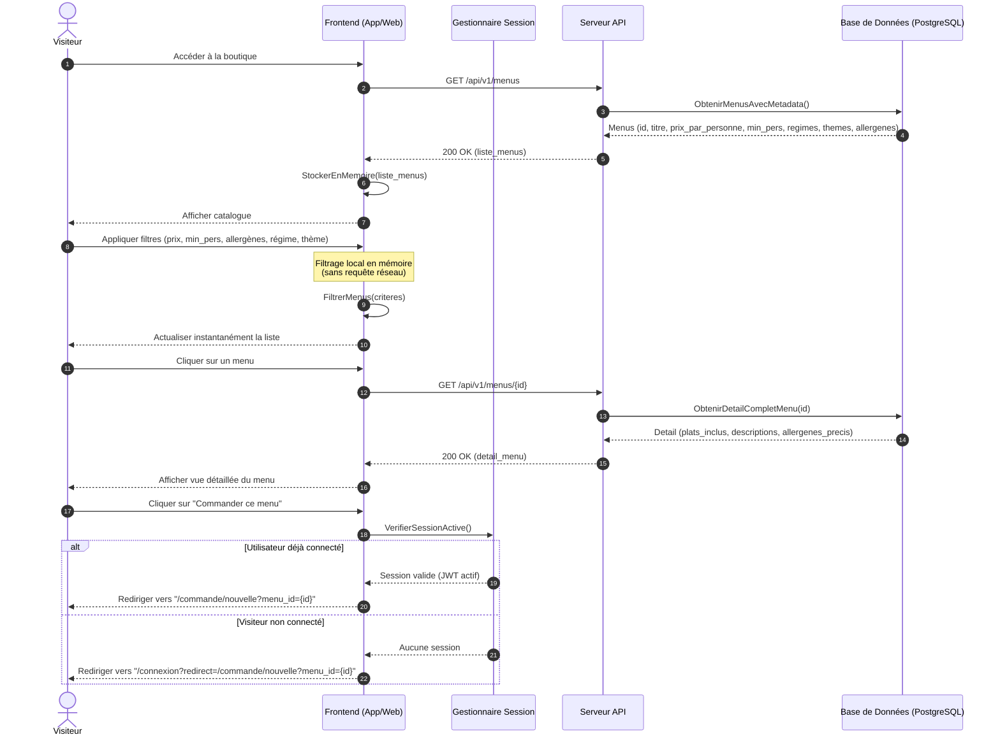
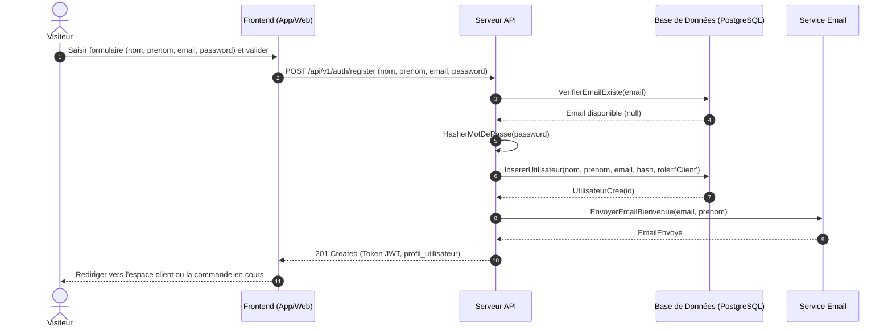
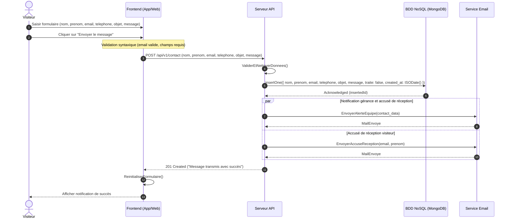

# Parcours Visiteur — Spécifications & Séquences

> Ce document détaille les parcours publics ouverts aux utilisateurs non authentifiés (visiteurs).

---

## Parcours 1 : Visiter la boutique, filtrer, consulter le détail et commander

### 1. Règles et données métier

* **Structure d'un Menu :** Un ou plusieurs plats, nombre minimal de personnes, prix unitaire par personne, description, quantité disponible, liste d'allergènes, régimes alimentaires compatibles et thèmes associés.
* **Filtres gérés côté client (mémoire locale) :** Nombre de personnes, budget/prix maximum, exclusion d'allergènes, régimes alimentaires, thèmes.
* **Navigation après clic « Commander » :**
  * Si l'utilisateur possède déjà une session active (jeton JWT valide) : redirection vers l'écran de création d'une nouvelle commande (`/commande/nouvelle?menu_id={id}`).
  * Sinon : redirection vers la mire de connexion (`/connexion?redirect=/commande/nouvelle?menu_id={id}`).

### 2. Diagramme de séquence Mermaid

---

## Parcours 2 : Inscription (Création de compte client)

### 1. Règles et données métier

* **Données requises :** Nom, prénom, adresse email valide, mot de passe.
* **Politique de mot de passe :** Minimum 10 caractères incluant au moins 1 majuscule, 1 minuscule, 1 chiffre et 1 caractère spécial (RGPD & ANSSI).
* **Rôle par défaut :** Attribué automatiquement au rôle Client (`user_role.CLIENT`).
* **Confirmation & Authentification :** Hachage salé du mot de passe (bcrypt), notification de bienvenue et remise immédiate d'un jeton JWT d'accès.

### 2. Diagramme de séquence Mermaid

---

## Parcours 3 : Prendre contact

### 1. Règles et données métier

* **Champs du formulaire :** Nom, prénom, email, numéro de téléphone (optionnel), objet du message, message.
* **Persistance NoSQL :** Stockage dans la collection MongoDB `contacts` pour un suivi et archivage sans altérer le schéma relationnel PostgreSQL.
* **Notifications :** Double envoi transactionnel (alerte interne à l'équipe + accusé de réception automatique au visiteur).

### 2. Diagramme de séquence Mermaid

